# Congress Data Pipeline & Bayesian Ideology Models

[](https://www.sqlite.org/)
[](https://www.r-project.org/)
[](https://mc-stan.org/)
[](https://creativecommons.org/licenses/by/4.0/)

A modular, production-ready R and SQLite research infrastructure uniting federal spending, electoral returns, environmental voting scores, energy infrastructure, and climate degree days across congressional districts and states (103rd–114th Congress, 1993–2016). 

The platform powers core Bayesian Stan item response theory (IRT) and vote-level campaign contribution inducement models directly from verified relational tables and analytical views.

---

## Table of Contents
1. [Executive Summary & Academic Findings](#1-executive-summary--academic-findings)
2. [Pipeline Architecture & System Design](#2-pipeline-architecture--system-design)
3. [The Three Core Complexity Challenges](#3-the-three-core-complexity-challenges)
   - [Challenge 1: Entity Resolution & Crosswalk Architecture](#challenge-1-unlinked-entity-resolution--crosswalk-architecture)
   - [Challenge 2: Spatiotemporal Alignment across Redistricting Plans](#challenge-2-spatiotemporal-alignment-across-redistricting-plans)
   - [Challenge 3: Bayesian Roll-Call Scaling & Latent Identification](#challenge-3-bayesian-roll-call-scaling--latent-identification)
4. [Repository Structure](#4-repository-structure)
5. [Pipeline Execution Order & Build Guide](#5-pipeline-execution-order--build-guide)
6. [Bayesian Model Execution & CLI Workflow](#6-bayesian-model-execution--cli-workflow)
7. [Data Manifest & Replication Provenance](#7-data-manifest--replication-provenance)
8. [License & Citation](#8-license--citation)

---

## 1. Executive Summary & Academic Findings

This repository provides the empirical and econometric backbone for analyzing congressional environmental policymaking, legislative voting behavior, and the spatial political economy of energy regulation. 

Its analytical architecture unites two primary research agendas:
1. **Legislative Ideology & Campaign Inducements:** Quantifying how political action committee (PAC) and individual campaign contributions sway marginal legislators on landmark energy and climate votes (such as the American Clean Energy and Security Act / Waxman-Markey H.R. 2454).
2. **Carbon Emissions, Electricity Trade & Redistricting:** Tracing embodied carbon in interstate electricity trade, district-level industrial composition, and voter exposure to clean energy transitions (including the EPA Clean Power Plan).

### Key Empirical Findings
- **Ideological Sorting & Polarization:** Estimates from the hierarchical 2PL IRT model reveal a stark acceleration in partisan polarization over environmental votes between 1993 and 2016. Party affiliation accounts for the dominant share of latent ideological variation ($\theta_i$), while district economic characteristics (fossil generation, median income, manufacturing intensity) exert substantial secondary pressure on moderates.
- **Vote Inducements on the Margin:** The Bayesian random-effects inducements model demonstrates that campaign contributions from energy and natural resources PACs systematically correlate with vote switching, with the highest marginal effects concentrated among centrist legislators whose district energy production diverges from their national party platform.
- **Interstate Grid Decoupling:** Zonal spatial extractions across 7,289 power plants demonstrate severe geographic divergence between where electricity is generated, where carbon is emitted, and where power is consumed—reinforcing political resistance to centralized carbon caps in net power-exporting congressional districts.

---

## 2. Pipeline Architecture & System Design

The pipeline transforms 27 upstream raw data feeds (~5.1 GB) into an integrated 14 GB SQLite database (`congress.sqlite`) featuring strict foreign keys, primary keys, automated deflators, and high-performance analytical views.

```mermaid
flowchart TD
    subgraph raw_sources ["27 Upstream Raw Feeds (raw/)"]
        R1["@unitedstates YAML<br/>Rosters & Terms"]
        R2["Voteview Roll Calls,<br/>Votes & Bio"]
        R3["CQ & FEC Election<br/>Returns & Margins"]
        R4["EIA SEDS, Prices &<br/>Surveys (759/906/923)"]
        R5["OpenSecrets (CRP)<br/>Campaign Finance"]
        R6["Census STF3D &<br/>ACS CD Profiles"]
        R7["NOAA CPC & PRISM<br/>Climate Rasters"]
        R8["CFFR Federal Spending<br/>Outlays & Programs"]
    end

    subgraph bootstrap ["Bootstrap Layer (sql/states.sql)"]
        S0["states<br/>(FIPS, Codes, Regions)"]
    end

    subgraph ingestion ["Base Ingestion Layer (data/*.R -> sql/tables/*.sql)"]
        I1["govtrack_info<br/>govtrack_term"]
        I2["voteview_members<br/>voteview_info<br/>voteview_cast"]
        I3["cq_elections<br/>fec_elections<br/>fec_special_elections"]
        I4["eia_plants<br/>eia_seds<br/>eia_prices<br/>eia_survey_gen"]
        I5["crp_candidates<br/>crp_committees<br/>crp_pacs<br/>crp_indivs"]
        I6["census_district<br/>census_state"]
        I7["noaa_degree_days<br/>prism_district"]
        I8["cffr_agency<br/>cffr_program<br/>cffr"]
        I9["lcv_votes"]
    end

    subgraph synthesis ["Secondary Synthesis Layer (synthesis/*.R)"]
        X1["crosswalk_members<br/>(99.91% OpenSecrets match)"]
        X2["cq_margins<br/>fec_margins_2014<br/>election_margins_vw"]
        X3["eia_plants_district<br/>eia_district_emissions<br/>eia_states"]
        X4["crp_contributions<br/>(Industry PAC & Indiv totals)"]
        X5["lcv_scores<br/>lcv_congress_scores<br/>retirements"]
    end

    subgraph panels ["Master Panel Assembly (synthesis/panel-*.R)"]
        P1["panel_house_annual<br/>(10,189 rows x 127 cols)"]
        P2["panel_senate_annual<br/>(2,360 rows x 127 cols)"]
    end

    subgraph views ["Analytical Roll-Call Views (sql/views/*-vw.sql)"]
        V1["panel_house_vw<br/>(180,418 vote records)"]
        V2["panel_senate_vw<br/>(28,868 vote records)"]
    end

    subgraph models ["Bayesian Estimation Layer (analysis/)"]
        M1["analysis/stan/hierarchical-rollcall.stan<br/>Hierarchical 2PL IRT Model"]
        M2["analysis/stan/inducements-rollcall.stan<br/>Vote-Level Inducements Model"]
    end

    raw_sources --> bootstrap
    bootstrap --> ingestion
    ingestion --> synthesis
    synthesis --> panels
    panels --> views
    views --> models
```



---

## 3. The Three Core Complexity Challenges

### Challenge 1: Unlinked Entity Resolution & Crosswalk Architecture
Congressional datasets originate from disparate institutions lacking uniform identification keys:
- `@unitedstates` uses `bioguide_id`, `govtrack_id`, and `thomas_id`.
- `Voteview` tracks members via integer `icpsr` codes and historical sequence numbers.
- `OpenSecrets (CRP)` indexes candidates via alphanumeric CIDs (e.g., `N00007360`).
- `Project Vote Smart` issues numeric `vsid` keys.
- State redistricting frequently alters district numbers between decennial censuses, causing naive string joins to collapse.

**Solution:** The unified crosswalk pipeline in [`synthesis/crosswalk-members.R`](synthesis/crosswalk-members.R) and schema [`sql/tables/crosswalk-members.sql`](sql/tables/crosswalk-members.sql) matches members hierarchically:
1. Exact key binding on `bioguide_id` and `icpsr_id` directly from `@unitedstates` YAML archives.
2. Chamber-, state-, district-, and temporal-window validation to resolve mid-term appointments, vacancies, and special elections.
3. OpenSecrets identifier patching leveraging biographical name scrubbing, resulting in **99.91% linkage coverage** (6,561 of 6,567 member-terms). Full details are documented in [`docs/crosswalk-specification.md`](docs/crosswalk-specification.md).

### Challenge 2: Spatiotemporal Alignment across Redistricting Plans
Tracking energy generation and emissions across time requires overlaying 7,289 power plants (`eia_plants`) and 4km continuous gridded PRISM climate rasters onto congressional districts whose geographic boundaries change across three decennial redistricting cycles:
- **103rd–107th Congresses:** 1990 Decennial Redistricting Plan.
- **108th–112th Congresses:** 2000 Decennial Redistricting Plan.
- **113th–114th Congresses:** 2010 Decennial Redistricting Plan.

**Solution:** 
- **Point-in-Polygon & Coastal Snapping:** [`synthesis/eia-plants-district.R`](synthesis/eia-plants-district.R) utilizes `sf::st_join` against UCLA congressional district GIS shapefiles. Power plants on coastal spits, municipal harbors, or islands outside baseline polygon edges are resolved using state-constrained nearest-neighbor searches (`sf::st_nearest_feature`), achieving 100% facility-to-district assignment (87,096 plant-congress records).
- **Physical Thermal Conversions:** Physical fuel consumption quantities (short tons of coal, barrels of oil, Mcf of natural gas) are standardized to thermal energy (MMBtu) and converted to metric tons of $\text{CO}_2$ emissions using EPA Mandatory Reporting Rule (40 CFR Part 98) coefficients in [`synthesis/eia-district-emissions.R`](synthesis/eia-district-emissions.R).
- **Zonal Climate Extraction:** [`data/prism.R`](data/prism.R) applies `terra::extract` with area-weighted averaging to aggregate monthly precipitation, minimum/maximum temperatures, and degree days into `prism_district` (109,632 rows). Methodological formulas and CPI-U deflator series are documented in [`docs/spatial-climate-specification.md`](docs/spatial-climate-specification.md).

### Challenge 3: Bayesian Roll-Call Scaling & Latent Identification
Traditional two-parameter logistic (2PL) item response theory (IRT) spatial voting models suffer from dual identification problems:
1. **Rotational & Scale Invariance:** Multiplying the latent traits $\theta_i$ by a constant $c$ and dividing discrimination parameters $\beta_j$ by $c$ preserves the likelihood.
2. **Polarity / Reflection Invariance:** Flipping the sign of all legislator ideal points ($\theta_i \to -\theta_i$) and discrimination parameters ($\beta_j \to -\beta_j$) produces identical likelihood values, causing MCMC chains to jump between political mirror universes.

**Solution:**
- **Structural Prior Identification:** Rather than applying fragile post-hoc sign flips, [`analysis/stan/hierarchical-rollcall.stan`](analysis/stan/hierarchical-rollcall.stan) identifies polarity structurally through an informative hierarchical prior:

```math
\begin{aligned}
\theta_i &\sim \mathcal{N}(X_i \gamma, \sigma_t^2) \\
\mu_{\gamma}[\text{party\_r}] &= 2.0, \quad \sigma_{\gamma}[\text{party\_r}] = 1.0 \\
\mu_{\gamma}[\text{intercept}] &= -1.0, \quad \sigma_{\gamma}[\text{intercept}] = 1.0
\end{aligned}
```

- **Polarity-Aligned Initialization:** MCMC chains are initialized with Democrats at $\theta^{(0)} = -1$ and Republicans at $\theta^{(0)} = +1$, locking chains into the standard Left/Right ideological orientation.
- **Non-Centered Parameterization:** Latent member parameters are parameterized as $\theta_{\text{raw}} \sim \mathcal{N}(0, 1)$, eliminating Neal's Funnel degeneracies in Stan's No-U-Turn Sampler (NUTS).
- **Draw Post-Processing:** [`analysis/helpers.R`](analysis/helpers.R) executes affine standardization across MCMC draws ($(\theta - \bar{\theta})/s_\theta$) to place ideal points on a normalized metric without distorting relative posterior distances.

---

## 4. Repository Structure

```
congress/
├── data/                         # Raw ingestion ETL scripts (populates base tables)
│   ├── states.R                  # Bootstrap state reference ingestion
│   ├── govtrack.R                # Official legislator rosters & term YAML parsing
│   ├── voteview.R                # Voteview members, roll calls, and cast votes
│   ├── cq.R                      # CQ congressional election returns
│   ├── fec.R                     # FEC election returns & special elections
│   ├── eia-plants.R              # EIA Form 860 power plant GPS data
│   ├── eia-factors.R             # EIA / EPA thermal and carbon factors
│   ├── eia-survey.R              # EIA Forms 759, 906, 920, 923 generation surveys
│   ├── eia-seds.R                # EIA SEDS consumption & energy prices
│   ├── opensecrets.R             # OpenSecrets bulk campaign contributions
│   ├── bls.R                     # BLS LAUS unemployment & CPI-U inflation
│   ├── bea.R                     # BEA GSP, personal income, and population
│   ├── cffr.R                    # Census CFFR federal spending outlays
│   ├── census.R                  # Census 1990 STF3D & 2000-2014 ACS CD profiles
│   ├── cd-maps.R                 # UCLA congressional district shapefiles
│   ├── noaa.R                    # NOAA CPC population-weighted degree days
│   ├── prism.R                   # PRISM gridded climate raster zonal extractions
│   ├── lcv-votes.R               # League of Conservation Voters roll-call lists
│   └── congress.R                # House and Senate legislative calendar sessions
├── synthesis/                    # Secondary ETL & master panel assembly scripts
│   ├── crosswalk-members.R       # Entity crosswalk (GovTrack, ICPSR, CRP, VSID)
│   ├── cq-margins.R              # CQ margin of victory and party vote shares
│   ├── fec-margins.R             # 2014 FEC margins & election_margins_vw
│   ├── eia-plants-district.R     # GIS spatial plant-to-district redistricting join
│   ├── eia-states.R              # State-level real energy prices and consumption
│   ├── eia-generation.R          # Plant-level MMBtu and CO2 emissions
│   ├── eia-district-emissions.R  # District-level generation & emissions aggregation
│   ├── prism.R                   # Annual district climate metrics aggregation
│   ├── lcv-scores.R              # Member annual & biennial LCV scorecard scores
│   ├── retirements.R             # Member turnover, casualty, and retirement flags
│   ├── opensecrets.R             # Candidate PAC & individual contribution totals
│   ├── panel-house.R             # House master panel assembly (panel_house_annual)
│   └── panel-senate.R            # Senate master panel assembly (panel_senate_annual)
├── analysis/                     # Econometric modeling & Bayesian Stan workflows
│   ├── stan/                     # Modernized Stan 2.30+ model definitions
│   │   ├── hierarchical-rollcall.stan  # Structural 2PL IRT model
│   │   └── inducements-rollcall.stan   # Campaign inducements random-effects model
│   ├── helpers.R                 # 2-SD predictor scaling & draw post-processing
│   ├── model-hierarchical.R      # Hierarchical IRT MCMC execution runner
│   ├── model-inducements.R       # Campaign inducements MCMC execution runner
│   └── results/                  # Serialized MCMC draws and summary CSVs (ignored)
├── sql/                          # Modular SQLite DDL definitions
│   ├── states.sql                # Foundational bootstrap schema (run first)
│   ├── tables/                   # Physical table schemas (*.sql)
│   └── views/                    # Analytical view definitions (*-vw.sql)
├── docs/                         # Technical specifications and documentation
│   ├── raw-data-manifest.md      # Full 27-feed provenance & archival manifest
│   ├── spatial-climate-specification.md # Physical conversions & spatial joins
│   ├── crosswalk-specification.md       # Entity resolution & matching logic
│   └── non-panel-data-sources.md        # Legacy audit of auxiliary manuscript data
├── raw/                          # Genuine upstream raw data files (git-ignored)
├── config.R                      # Central environment & SQLite connection helpers
└── renv.lock                     # Reproducible R package environment state
```

---

## 5. Pipeline Execution Order & Build Guide

The pipeline follows a strict dependency hierarchy. Because SQLite enforces relational integrity via `PRAGMA foreign_keys = ON;`, tables must be built in order:

### Step 1: Environment Initialization
Restore the pinned R dependency snapshot:
```R
renv::restore()
```

### Step 2: The Bootstrap Convention (`states`)
Before running any other script, the foundational lookup table `states` must be initialized from [`sql/states.sql`](sql/states.sql). All downstream geographic joins and FIPS foreign keys depend on this table:
```bash
Rscript data/states.R
```

### Step 3: Raw Ingestion ETL (`data/`)
Populate base tables from raw files in `raw/`:
```bash
Rscript data/govtrack.R
Rscript data/voteview.R
Rscript data/cq.R
Rscript data/fec.R
Rscript data/bls.R
Rscript data/bea.R
Rscript data/cffr.R
Rscript data/census.R
Rscript data/eia-plants.R
Rscript data/eia-factors.R
Rscript data/eia-seds.R
Rscript data/eia-survey.R
Rscript data/opensecrets.R
Rscript data/cd-maps.R
Rscript data/noaa.R
Rscript data/prism.R
Rscript data/lcv-votes.R
Rscript data/congress.R
```

### Step 4: Secondary Synthesis ETL (`synthesis/`)
Execute synthesis pipelines that query SQLite base tables to construct derived features, crosswalks, and master panels:
```bash
# 1. Entity resolution & election margins
Rscript synthesis/crosswalk-members.R
Rscript synthesis/cq-margins.R
Rscript synthesis/fec-margins.R

# 2. Energy, emissions & spatial overlays
Rscript synthesis/eia-plants-district.R
Rscript synthesis/eia-generation.R
Rscript synthesis/eia-states.R
Rscript synthesis/eia-district-emissions.R
Rscript synthesis/prism.R

# 3. Campaign finance, voting scores & retirements
Rscript synthesis/opensecrets.R
Rscript synthesis/lcv-scores.R
Rscript synthesis/retirements.R

# 4. Master panel assembly & analytical views
Rscript synthesis/panel-house.R
Rscript synthesis/panel-senate.R
```

### Step 5: Verification & Concordance
The panel synthesis scripts verify that `panel_house_annual` (10,189 rows × 127 columns) and `panel_senate_annual` (2,360 rows × 127 columns) match legacy panel definitions with **>99.9% statistical concordance**.

---

## 6. Bayesian Model Execution & CLI Workflow

The models in `analysis/` estimate Bayesian ideal points and campaign contribution inducements using Hamiltonian Monte Carlo (HMC) in Stan 2.30+.

### 6.1 Hierarchical 2PL IRT Model
Estimates legislator ideal points $\theta_i$ along a single ideological dimension with a structural regression on member party, district income, and energy intensity:
```bash
# Estimate House ideal points (4 chains, 2000 iterations)
Rscript analysis/model-hierarchical.R --house --iter 2000 --warmup 1000 --chains 4

# Estimate Senate ideal points for the 111th Congress
Rscript analysis/model-hierarchical.R --senate --congress 111

# Smoke test with short chains
Rscript analysis/model-hierarchical.R --house --test
```

### 6.2 Campaign Inducements Random-Effects Model
Estimates vote-specific inducements from PAC and individual campaign contributions on specific high-stakes environmental roll calls:
```bash
# Estimate Waxman-Markey (H.R. 2454) inducements in the 111th Congress
Rscript analysis/model-inducements.R --house --congress 111 --bill "hr2454"

# Smoke test inducements model
Rscript analysis/model-inducements.R --house --congress 111 --test
```

Fitted draws and tidy posterior summary statistics are saved directly to `analysis/results/` (`summary_*.csv` and `fit_*.rds`).

---

## 7. Data Manifest & Replication Provenance

External replication and research provenance are documented across dedicated technical specifications:
- **[docs/raw-data-manifest.md](docs/raw-data-manifest.md):** Detailed provenance catalog for all 27 raw data feeds, listing canonical upstream URLs, schema keys, licensing conditions, and full pipeline replication instructions.
- **[docs/spatial-climate-specification.md](docs/spatial-climate-specification.md):** Thermal unit conversions (MMBtu), EPA carbon emissions factors, spatial nearest-neighbor joins, and BLS CPI-U real deflators.
- **[docs/crosswalk-specification.md](docs/crosswalk-specification.md):** Detailed resolution algorithms linking Bioguide, GovTrack, ICPSR, OpenSecrets CID, and VoteSmart identifiers.
- **[docs/non-panel-data-sources.md](docs/non-panel-data-sources.md):** Audit of 9 auxiliary legacy datasets (Clean Power Plan Goal Visualizer, Stewart Committee Rosters, ADAGE, etc.) used for standalone figures.

---

## 8. License & Citation

- **Code:** Licensed under the [MIT License](LICENSE).
- **Documentation & Data Panels:** Licensed under [Creative Commons Attribution 4.0 International (CC BY 4.0)](https://creativecommons.org/licenses/by/4.0/).
- **Database Architecture:** Licensed under the [Open Database License (ODbL 1.0)](https://opendatacommons.org/licenses/odbl/1-0/).

When using this pipeline, database, or empirical panels in academic work, please cite:
```bibtex
@misc{congress_sqlite_pipeline_2026,
  title={Legislative Ideology, Campaign Contributions, and Environmental Policy in the U.S. Congress (103rd--114th Congress)},
  author={Johnson, Jacob},
  year={2026},
  howpublished={\url{https://github.com/johnson-shuffle/congress}},
  note={R/SQLite Research Infrastructure and Bayesian Stan Estimation Suite}
}
```
